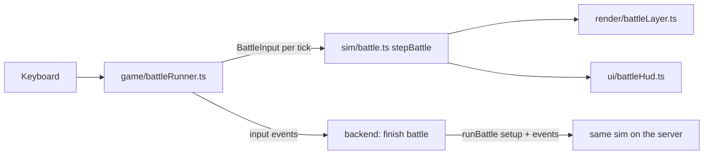

# Design Document: Combat

## Overview
`src/sim/battle.ts` holds a pure battle simulation that steps at the fixed 30 ticks per second. A battle is fully described by a `BattleSetup` (seed, mode, island, defenses, the player's loadout, the ghost fleet) and the player's input events. The client runs the battle live and records its inputs; the server runs `runBattle(setup, events)` and trusts only its own result.



## Data model
```ts
type BattleMode = 'assault' | 'siege';
type DefenseType = 'cannonTower' | 'spiritLantern' | 'boneCatapult' | 'mine';
interface PlacedDefense { type: DefenseType; level: 1 | 2 | 3; slot: number }
interface Loadout { hull: number; cannon: number; salt: number; barrel: number; bats: number; gunner: CrewState; navigator: CrewState }
interface BattleSetup { seed; mode; island: { radius; living; level; seed }; defenses: PlacedDefense[]; loadout: Loadout; fleet: { count; level } }
interface BattleInput { rudder: number; sailLevel: number; flags: number } // flags: 1 port, 2 starboard, 4 barrel, 8 bats, 16 salt, 32 retreat
type InputEvent = readonly [tick: number, rudder: number, sailLevel: number, flags: number];
```

Structures stand on a ring of slots at 60% of the island's radius; mines float on a ring in the water. Slot positions come from `slotPosition` and `mineSlotPosition` in `sim/layout.ts`, so the renderer and the simulation always agree.

## Rules per tick
1. Retreat ends an assault.
2. The player's ship and every ghost ship step with `stepShip` (ghosts use their own speed table, halved while slowed) and `resolveCollisions` against the arena.
3. Player weapons fire if held and ready. Broadsides auto-aim at the nearest hostile target in range and inside a 55° arc either side of the beam, leading moving ships. The keep counts as in range from `BATTLE.keepReach` further out, because it stands at the heart of the island.
4. Each standing defense with a target in range fires. Cannon Towers and Spirit Lanterns lead moving ships; catapults do not.
5. Ghost ships fire at the nearest structure or player ship in range. In an assault the ghosts belong to the island: they start on the ring around it, patrol it while the player is far, steer for the player once it comes within `GHOSTS.guardReach` of the ring (circling it at `GHOSTS.huntDistance`), and fire only at the player's ship. The player's weapons can hit them; the island's towers and mines never can.
6. Shots land when their flight time ends. A single-target shot hits the nearest hostile entity whose hit circle contains the landing point; an area shot hits every hostile entity in its radius. Damage = base damage × the multiplier for the shot type against the target class.
7. Burning zones damage hostile entities inside them every tick.
8. Hostile ships inside a mine's trigger radius set it off.
9. End conditions are checked.

| Shot | vs living ship | vs ghost | vs structure |
|---|---|---|---|
| Cannonball | 1 | 0.5 (1 with a ghost Gunner) | 1 |
| Salt Shot | 0.4 | 1, plus slow | 0.4 |
| Cannon Tower | 1 | 0.5 | |
| Spirit Lantern | 0.4 | 1 | |
| Bone Catapult | 0.8 | 0.8 | |
| Ghost bolt | 1 | | 1 |
| Witchfire, mines | 1 | 1 | 1 (witchfire only) |

## Correctness Properties

**Property 1: Same setup and inputs, same battle.** *For any* setup and input events, running the battle twice gives identical final states.
**Validates: Requirement 5.1**

**Property 2: A live battle replays exactly.** *For any* setup and any per-tick input stream, stepping live while recording change events, then replaying the events with `runBattle`, gives the same final state.
**Validates: Requirement 5.2**

**Property 3: The battle state stays valid.** *For any* setup and inputs, at every tick all numbers are finite, health stays in [0, max], every ship is inside the arena and outside the island's collision circle.
**Validates: Requirement 5.5**

**Property 4: Health never rises.** *For any* setup and inputs, no structure's or ship's health increases from one tick to the next.
**Validates: Requirement 5.4**

**Property 5: Every battle ends, with a consistent score.** *For any* setup and inputs, the battle ends within the time limit; destruction is in [0, 1]; stars equal (destruction ≥ 0.5) + keep destroyed + (destruction = 1).
**Validates: Requirements 4.1, 4.2, 4.3**

**Property 6: The two threats need two defenses.** *For any* level, a Cannon Tower's damage to a ghost is half its damage to a living ship, and a Spirit Lantern's damage to a living ship is 40% of its damage to a ghost.
**Validates: Requirements 2.1, 2.2**

**Property 7: Veiled ghosts can't be targeted by towers.** *For any* siege, every shot fired at a ghost by a defense other than a Spirit Lantern targets a ghost that was revealed on that tick.
**Validates: Requirements 2.5, 3.4**

**Property 8: Malformed inputs are harmless.** *For any* list of arbitrary input events (non-finite, out of order, out of range), `runBattle` finishes and gives the same result as running the sanitized list.
**Validates: Requirement 5.3**

**Property 9: Every keep is within reach.** *For any* island radius the world can generate, haunted or home, a ship sailing up to 16 m off the shore can reach the keep at the centre with its broadside, a ship at the shore can reach every tower slot, and ghosts circling Last Light can reach its keep. (Added after the scripted fort attack showed keeps out of range. Widened in the balance pass, when the autopilot sank every tower on Bonefire Isle but could not reach its keep: broadsides now reach the keep `BATTLE.keepReach` further than other targets.)
**Validates: Requirements 1.1, 3.2, 4.3**

**Property 10: The island's ghosts fight for it.** *For any* assault with ghost ships and any inputs, every shot fired by a ghost or a tower that hits something hits the player's ship, and the battle ends only when the fort falls, the ship sinks or dawn comes.
**Validates: Requirements 3.5, 3.6, 4.1**

## Testing strategy
fast-check generates setups (modes, island sizes, random defense layouts and loadouts, fleet sizes) and input streams. Battles are capped at the time limit, so each run is bounded. Example tests cover a broadside sinking a lone tower and a siege where towers alone repel a small fleet.
