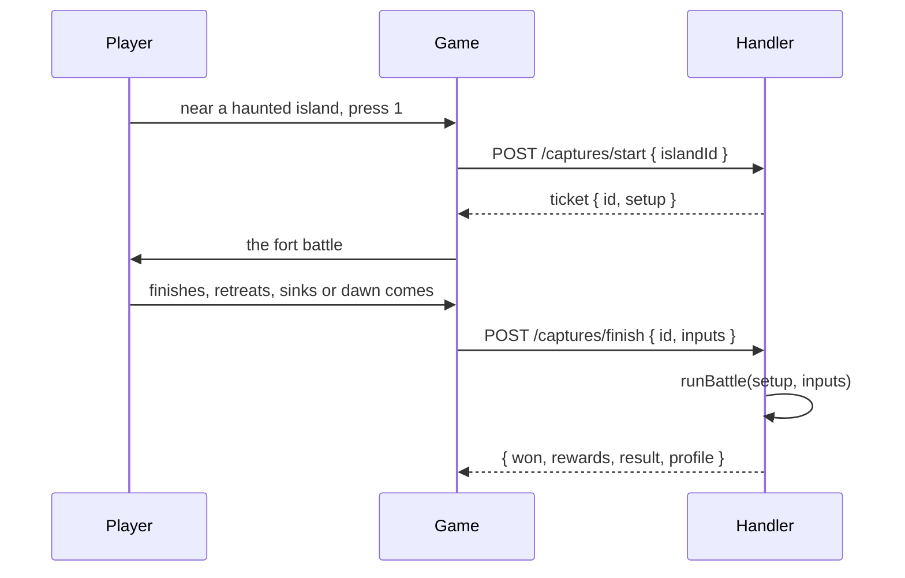

# Design Document: Island capture

## Fort levels
Every number lives in `FORTS` in `src/sim/balance.ts`.

`fortLevelAt(distance)` in `sim/world.ts` turns an island's distance from Last Light into a level: `1 + floor(min(0.9999, (distance / FORTS.levelReach)²) × 5)`. Squaring the share spreads the levels by area, so each level covers about a fifth of the sea and the first island (220 to 280 m ahead) is always level 1. `generateWorld` picks a distance first, then a shore radius from `FORTS.islandRadius` for that level, so harder islands are visibly bigger. `fortDifficulty(island)` in `sim/layout.ts` reads the level back from the island's position.

| Level | Island radius | Towers (slots) | Tower levels | Mines | Keep level | Island ghosts | Time limit |
|---|---|---|---|---|---|---|---|
| 1 | 26 to 34 m | 3 (5) | 1 | 0 | 1 | none | 150 s |
| 2 | 32 to 42 m | 4 (6) | 1 to 2 | 1 | 1 | 1 at level 1 | 165 s |
| 3 | 38 to 50 m | 5 (7) | 2 | 2 | 2 | 2 at level 1 | 180 s |
| 4 | 46 to 58 m | 6 (8) | 2 to 3 | 3 | 3 | 2 at level 2 | 195 s |
| 5 | 54 to 66 m | 7 (9) | 2 to 3 | 3 | 3 | 3 at level 2 | 225 s |

Level 5 started with level-3 towers, 4 mines, level-3 ghosts and 210 s; the balance report showed a fully refitted ship winning 1 run in 12, so it was softened to the numbers above.

The first tower is always a Cannon Tower; the rest are Cannon Towers, Spirit Lanterns and, from level 2, Bone Catapults. `fortSetup(island, loadout, seed)` in `sim/layout.ts` builds the whole battle setup, so the server and the practice battle on the title screen use the same fort.

Island ghosts are an assault's `fleet` (see the combat spec, Requirement 3.5): they rise on a ring around the island, hunt the attacker and fire only at the player's ship.

## Lantern Lines
`src/sim/puzzle.ts` (pure), used by the Locker escape:
```ts
type CellKind = 'empty' | 'mirror' | 'totem' | 'rock';
type Orientation = 0 | 1; // 0 is '/', 1 is '\'
interface Puzzle { size: number; sourceRow: number; cells: CellKind[]; start: Orientation[]; solution: Orientation[] }
generatePuzzle(seed): Puzzle
trace(puzzle, orientation): { steps: TraceStep[]; lit: number[]; blocked: boolean; exited: boolean }
isSolved(puzzle, orientation): boolean
sanitizeOrientation(puzzle, raw: unknown): Orientation[]
```
Generation walks a beam from the source with a seeded random number generator, turning at some cells (which become mirrors set to make that turn) and never revisiting a cell. Totems go on straight cells of the path; rocks and decoy mirrors go off the path. The start layout flips path mirrors until the puzzle is unsolved. A reflection maps direction (dr, dc) to (−dc, −dr) for `/` and (dc, dr) for `\`.

## Capture flow

`/captures/start` accepts an optional `method`, and refuses anything but `"fort"`. The server uses the standard sea (`WORLD.defaultSeed`), so island ids, levels and seeds are the same for everyone.

## Fort graphics
`render/fortMeshes.ts` builds a haunted fort as one merged mesh: a ring of stone curtain walls around the keep with battlements, a gate, corner turrets with slate roofs and spectral braziers, missing stones for a ruined look, all sitting on the terrain. The wall count, height and turret size grow with the level. The open sea shows every haunted island's fort and ghost spire in one more draw call; the battle view adds rocks, graves and dead trees as instanced props.

## Correctness Properties

**Property 1: Every puzzle has a solution.** *For any* seed, the generated solution lights every totem.
**Validates: Requirements 1.1, 1.2**

**Property 2: No puzzle starts solved.** *For any* seed, the starting layout is not solved.
**Validates: Requirement 1.2**

**Property 3: The beam behaves.** *For any* seed and any mirror layout, the trace ends within size² × 4 steps, never enters a rock, and is the same every time.
**Validates: Requirements 1.3, 1.4**

**Property 4: Solved means every totem is lit.** *For any* seed and layout, `isSolved` is true exactly when the trace lights every totem, and values on non-mirror cells make no difference.
**Validates: Requirement 1.4**

**Property 5: Only a real win captures a fort.** *For any* recorded inputs, finishing a fort ticket captures the island exactly when the server's replay destroys the keep.
**Validates: Requirement 2.3**

**Property 6: Tickets are single-use and captures happen once.** *For any* sequence of start and finish calls, with any method, an island is captured at most once, a ticket is accepted at most once, only fort battles start, and Last Light can never be captured.
**Validates: Requirements 2.4, 2.5**

**Property 7: Forts get harder further out.** *For any* world seed, a haunted island further from Last Light never has a lower fort level than a nearer one, and every haunted island's radius lies inside its level's range.
**Validates: Requirements 3.1, 3.2**

**Property 8: Each level is a stronger fort.** *For any* haunted island, its battle setup has exactly the towers, tower levels, mines, keep level, island ghosts and time limit `FORTS` sets for its level, and none of them is weaker than at the level before.
**Validates: Requirements 3.3, 3.4, 3.5**

## Testing strategy
Puzzle properties use random seeds and random layouts. Capture properties run the handler with a memory store; winning inputs come from a scripted captain who circles the fort firing both broadsides. Fort properties generate random worlds and islands. `server/balance.test.ts` checks the curve with the scripted captain: a new captain takes every level-1 fort, can't take a level-5 fort, and a fully refitted ship can.
