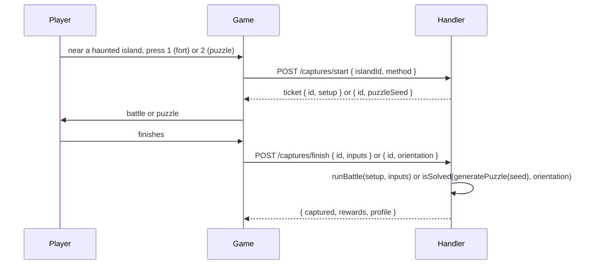

# Design Document: Island capture

## Lantern Lines
`src/sim/puzzle.ts` (pure):
```ts
type CellKind = 'empty' | 'mirror' | 'totem' | 'rock';
type Orientation = 0 | 1; // 0 is '/', 1 is '\'
interface Puzzle { size: number; sourceRow: number; cells: CellKind[]; start: Orientation[]; solution: Orientation[] }
generatePuzzle(seed): Puzzle
trace(puzzle, orientation): { steps: TraceStep[]; lit: number[]; blocked: boolean; exited: boolean }
isSolved(puzzle, orientation): boolean
sanitizeOrientation(puzzle, raw: unknown): Orientation[]
```
Generation walks a beam from the source with a seeded random number generator, turning at some cells (which become mirrors set to make that turn) and never revisiting a cell. Totems go on straight cells of the path; rocks and decoy mirrors go off the path. The start layout flips path mirrors until the puzzle is unsolved. A reflection maps direction (dr, dc) to (−dc, −dr) for `/` and (dc, dr) for `\`.

## Capture flow

The server uses the standard sea (`WORLD.defaultSeed`), so island ids and seeds are the same for everyone.

## Correctness Properties

**Property 1: Every puzzle has a solution.** *For any* seed, the generated solution lights every totem.
**Validates: Requirements 1.1, 1.2**

**Property 2: No puzzle starts solved.** *For any* seed, the starting layout is not solved.
**Validates: Requirement 1.2**

**Property 3: The beam behaves.** *For any* seed and any mirror layout, the trace ends within size² × 4 steps, never enters a rock, and is the same every time.
**Validates: Requirements 1.3, 1.4**

**Property 4: Solved means every totem is lit.** *For any* seed and layout, `isSolved` is true exactly when the trace lights every totem, and values on non-mirror cells make no difference.
**Validates: Requirement 1.4**

**Property 5: Only a real win captures a fort.** *For any* recorded inputs, finishing a fort ticket captures the island exactly when the server's replay destroys the keep.
**Validates: Requirement 2.3**

**Property 6: Tickets are single-use and captures happen once.** *For any* sequence of start and finish calls, an island is captured at most once, a ticket is accepted at most once, and Last Light can never be captured.
**Validates: Requirement 2.5**

## Testing strategy
Puzzle properties use random seeds and random layouts. Capture properties run the handler with a memory store; winning inputs come from a scripted captain who circles the fort firing both broadsides.
