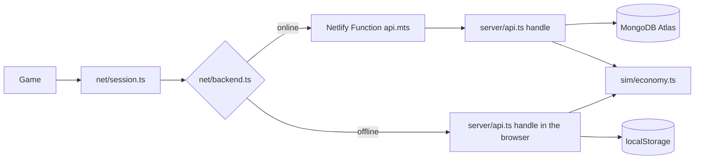

# Design Document: Persistence

## Overview

The handler is plain TypeScript using only web standards (`Request`, `Response`, `crypto`), so it runs unchanged in Netlify's Node runtime, Vite's dev server and the browser. Every rule that changes progress lives in `src/sim/economy.ts` (pure functions); the handler loads a profile, applies a rule, saves it.

## Data model
```ts
interface Resources { gold: number; cursedGold: number; ectoplasm: number }
interface Profile {
  version: 1; id: string; name: string; tokenHash: string; createdAt: number;
  resources: Resources; homeLevel: 1 | 2 | 3; defenses: PlacedDefense[];
  weapons: { hull: number; cannon: number; salt: number; barrel: number; bats: number };
  crew: { gunner: CrewSlot; navigator: CrewSlot };
  captured: number[]; tributeAt: number; infamy: number; protectedUntil: number;
  stats: { raidsWon: number; captures: number; ghostRaidsRepelled: number; ghostShipsSunk: number };
  reports: Report[]; battle: PendingBattle | null;
}
```
Store keys: `player:<id>` holds a profile; `index` holds a short public entry per player (name, infamy, home level, protection) for the leaderboard and raid targets.

## Routes (this feature)
| Route | Does |
|---|---|
| `GET /api/health` | `{ ok: true }` |
| `POST /api/guest` | Creates a guest captain; returns `{ token, profile }` |
| `GET /api/profile` | Returns the caller's profile |
| `POST /api/rename` `{ name }` | Renames the caller's captain |
| `POST /api/collect` | Collects tribute |

Later features add their routes to the same router.

## Correctness Properties

**Property 1: Resources stay valid.** *For any* sequence of earnings, spending and tribute, every resource stays a whole number in [0, cap], with gold + cursed gold ≤ the gold cap.
**Validates: Requirements 3.1, 3.2**

**Property 2: Spending is exact and takes cursed gold first.** *For any* resources and cost, spending succeeds exactly when affordable; then gold + cursed gold drops by exactly the gold cost, cursed gold drops by min(cursed gold, cost), and ectoplasm drops by its cost. Otherwise nothing changes.
**Validates: Requirements 3.3, 3.4**

**Property 3: Tribute is counted once.** *For any* captured count and collection times, collecting at t1 then t2 pays the same as collecting once at t2 (when below the cap), and collecting twice at the same moment pays nothing the second time.
**Validates: Requirements 4.1, 4.2**

**Property 4: Profiles round-trip.** *For any* guest, the profile returned after a reload equals the one returned at creation, and no response contains a token hash.
**Validates: Requirements 1.2, 2.4**

**Property 5: Wrong tokens change nothing.** *For any* malformed or wrong token, every route that needs a captain answers 401 and the store is unchanged.
**Validates: Requirement 2.2**

**Property 6: Names are validated.** *For any* string, rename succeeds exactly when it matches the name rule.
**Validates: Requirement 1.4**

## Testing strategy
Property tests run the handler against a memory store with a fake clock and fake random numbers, so every run is reproducible.
