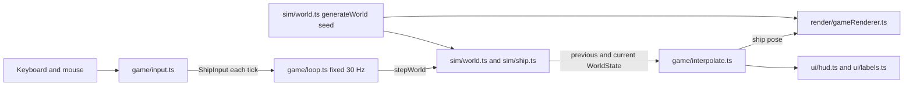

# Design Document: Sailing

## Overview
The simulation owns the rules and runs at a fixed 30 ticks per second. The renderer draws an interpolated view of the last two ticks at the display's frame rate. Everything visual (waves, bobbing, wake, glows) is computed in the renderer from the simulation state and the render clock, so it can never change the outcome of a step. This split is what later lets the server replay raids exactly.



## Components

| File | Responsibility |
|---|---|
| `sim/balance.ts` | Every gameplay number: `TICK_SECONDS`, `MAX_STEP_SECONDS`, `SHIP`, `WORLD` |
| `sim/math.ts` | `clamp`, `finiteOr`, `moveToward`, `wrapAngle`, `angleDelta`, `lerpAngle`, `headingToBearing` |
| `sim/rng.ts` | `createRng(seed)` (mulberry32), `hashSeed(text)` (FNV-1a), `mixSeed(seed, salt)` |
| `sim/ship.ts` | `ShipState`, `ShipInput`, `createShip`, `sanitizeInput`, `stepShip` |
| `sim/world.ts` | `Island`, `World`, `WorldState`, `generateWorld(seed)`, `createWorldState`, `stepWorld`, `resolveCollisions` |
| `game/loop.ts` | Fixed-timestep loop with an accumulator; caps a frame at 0.25 s so a background tab can't cause a spiral |
| `game/input.ts` | Keyboard state: sail setting on key press, rudder from held keys; releases keys on window blur |
| `game/interpolate.ts` | `interpolateShip(previous, current, alpha)` |
| `render/palette.ts` | All colors |
| `render/waves.ts` | The wave table, `sampleWaveHeight` for the CPU and `waveHeightGlsl` for the GPU, both built from the same table |
| `render/ocean.ts` | Faceted sea shader, moon glitter, lantern pools, grid snapped to world positions |
| `render/sky.ts` | Sky dome with gradient and moon, star points |
| `render/islands.ts` | Island terrain meshes and instanced props |
| `render/shipMesh.ts` | Procedural low-poly ship with sails, lantern and two crew |
| `render/effects.ts` | Lantern glows, ghost wisps and the foam wake, one `Points` draw call each |
| `render/cameraRig.ts` | Intro orbit, chase camera, mouse orbit and zoom |
| `render/gameRenderer.ts` | Creates the scene and draws a frame; reports stats |
| `ui/hud.ts`, `ui/intro.ts`, `ui/labels.ts`, `ui/notice.ts` | DOM overlay built with `textContent` only |
| `main.ts` | WebGL 2 check, URL options (`seed`, `quality`, `skipIntro`), wiring, debug API |

## Data models

```ts
type SailLevel = 0 | 1 | 2;

interface ShipState {
  x: number; z: number;     // metres
  heading: number;          // radians in (−π, π], 0 faces +Z
  speed: number;            // m/s, 0..SHIP.maxSpeed
  sailLevel: SailLevel;     // the order
  sail: number;             // deployment 0..1
  rudder: number;           // −1..1, actual rudder position
}

interface ShipInput { rudder: number; sailLevel: number }   // untrusted, sanitized by the simulation

interface Island { id: number; name: string; kind: 'home' | 'haunted'; x: number; z: number; radius: number; seed: number }
interface World { seed: number; radius: number; islands: Island[]; spawn: { x: number; z: number; heading: number } }
interface WorldState { tick: number; ship: ShipState }
```

## The ship step
For each step, with `dt` clamped to [0, `MAX_STEP_SECONDS`]:
1. Sanitize the input (Requirement 5.2).
2. `sail = moveToward(sail, sailLevel / 2, sailRate × dt)`
3. `rudder = moveToward(rudder, input.rudder, rudderRate × dt)`
4. `target = maxSpeed × sail × (1 − turnDrag × |rudder|)`; `speed = moveToward(speed, target, (speed < target ? accel : decel) × dt)`
5. `steerage = minSteerage + (1 − minSteerage) × clamp(speed / steerageSpeed, 0, 1)`; `heading = wrapAngle(heading − rudder × maxTurnRate × steerage × dt)`
6. `x += sin(heading) × speed × dt`, `z += cos(heading) × speed × dt`

Then `resolveCollisions` pushes the ship out of any collision circle along the line from the island's centre (or straight back along the heading if the ship is exactly at the centre), then pulls it back inside the world's edge. In both cases `impact = clamp(how directly the bow points into the obstacle, 0, 1)` and `speed = min(speed, maxSpeed × shoreSlide × (1 − impact))`. World generation keeps islands far enough from each other and from the edge that at most one correction applies per step.

## Rendering
- **Sea:** an 800 m square grid (4 m cells on High, 8 m on Low) that follows the ship but snaps to whole cells, so vertices never slide over the waves. The vertex shader adds four directional sine waves. The fragment shader takes a flat normal from screen-space derivatives, lights it with the moon and up to four lantern pools, adds a sharp moon glitter and a horizon reflection at grazing angles, applies fog, and fades to the fog color at the grid's edge so the sea has no visible end.
- **Waves on the CPU:** each wave's phase is computed in double precision on the CPU and sent as a uniform, so the GPU only works with small numbers and the CPU sample matches what is drawn.
- **Sky:** a gradient dome (not tone mapped, so its horizon exactly matches the fog color) with the moon and its halo drawn in the same shader, plus 1,400 twinkling star points.
- **Islands:** a jittered radial terrain per island with face colors for sand, moss and rock; haunted islands use a grey, dead palette. Props (palms, dead trees, rocks, tombstones, lantern posts) are one `InstancedMesh` per type for the whole world. Last Light has a lighthouse and a dock.
- **Ship:** a lofted hull, deck, bulwarks, two masts, bowsprit and two crew merged into one vertex-colored mesh, plus four sail meshes that furl from their yards, a flag and a stern lantern.
- **Glows and particles:** all lantern glows share one additive `Points` draw call that ignores fog, so lanterns show through it. Ghost wisps are another, animated on the GPU. The wake is a third, updated on the CPU from a ring buffer.
- **Lights:** a hemisphere light, the moon as a directional light, and at most three point lights: the ship's lantern, Last Light's lighthouse and the nearest haunted island's ghost light.

### Draw-call estimate (High)
| Item | Draw calls |
|---|---|
| Sky dome, stars | 2 |
| Sea | 1 |
| Island terrain | 14 |
| Instanced props and lantern glass | 7 |
| Lighthouse and dock | 2 |
| Ship (hull, 4 sails, flag, lantern) | 7 |
| Glows, wisps, wake | 3 |
| **Total** | **about 36** (budget 150) |

## Correctness Properties
*A property is a statement that must hold for every valid input, not just for chosen examples. Each property below becomes one fast-check test with the same number and title.*

**Property 1: The ship's state stays valid.** *For any* valid ship state, any input (including out-of-range and non-finite values) and any dt (including non-finite), the next state has finite values, speed in [0, maxSpeed], deployment in [0, 1], sail setting in {0, 1, 2}, rudder in [−1, 1] and heading in (−π, π].
**Validates: Requirements 1.5, 2.4, 5.2, 5.3**

**Property 2: Sails, rudder and speed change at limited rates.** *For any* valid state in open water and any input, one step changes the deployment by at most sailRate × dt, the rudder by at most rudderRate × dt, and the speed by at most accel × dt upward and decel × dt downward.
**Validates: Requirements 1.3, 1.4, 2.2**

**Property 3: Furled sails stop the ship.** *For any* valid state and any rudder input, holding the sail setting at Furled for `1 / sailRate + maxSpeed / decel` seconds (plus two ticks for rounding) brings the speed to exactly 0.
**Validates: Requirement 1.6**

**Property 4: The rudder turns the ship the right way.** *For any* valid state with the rudder already hard over and dt in [0.001, 0.1], a starboard rudder lowers the heading (raises the bearing) and a port rudder raises it; with the rudder centred and no rudder input, the heading does not change.
**Validates: Requirement 2.3**

**Property 5: The ship moves along its heading.** *For any* valid state in open water and any input, the step's displacement has length speed′ × dt and points along heading′.
**Validates: Requirement 2.5**

**Property 6: Islands and the world's edge are solid.** *For any* seed, any start outside every collision circle and inside the world, and any sequence of inputs, the ship never ends a step inside a collision circle or outside the world.
**Validates: Requirements 4.1, 4.2**

**Property 7: No teleporting.** *For any* seed, valid start, input and dt, one step moves the ship at most 2 × maxSpeed × dt.
**Validates: Requirement 4.3**

**Property 8: Same inputs, same result.** *For any* seed, start and input sequence, running the sequence twice gives identical states.
**Validates: Requirement 5.1**

**Property 9: The archipelago is well formed.** *For any* seed, the world has `islandCount` islands, the home island at the centre, at least `islandGap` of water between shores, every shore at least `edgeMargin` inside the edge, unique names, a spawn outside every collision circle, and the first haunted island 220 to 280 m out within 20° of the spawn heading.
**Validates: Requirements 3.1, 3.3, 3.4, 3.5, 3.6**

**Property 10: The archipelago is reproducible.** *For any* seed, generating the world twice gives identical worlds.
**Validates: Requirement 3.2**

**Property 11: The random number generator is reproducible and in range.** *For any* seed, two generators give the same sequence; `next()` is in [0, 1); `int(a, b)` is an integer in [a, b].
**Validates: Requirements 3.2, 5.1**

**Property 12: The simulation is pure.** The source files in `src/sim/` (excluding tests) never mention `Math.random`, `Date`, `performance`, timers, `document`, `window` or `three`.
**Validates: Requirement 5.4** (a static check rather than a generated-input test)

**Property 13: Wave heights are bounded.** *For any* position and time, the sampled wave height is within ± the sum of the wave amplitudes.
**Validates: Requirement 6.2**

**Property 14: Heading interpolation takes the short way round.** *For any* two headings and any t in [0, 1], `lerpAngle` returns the start at t = 0, the end at t = 1, and in between stays on the shorter arc between them.
**Validates: Requirement 6.5**

## Error handling
| Situation | Behavior |
|---|---|
| No WebGL 2 | A plain message explaining that the game needs a browser with WebGL 2, with links to current Chrome, Edge and Firefox |
| WebGL context lost | The loop stops and a message with a Reload button appears |
| Background tab | `requestAnimationFrame` pauses; when it resumes, the frame time is capped at 0.25 s |
| Bad URL options | Unknown `quality` values fall back to High; `seed` text is hashed, so any text works |

## Testing strategy
- **Property tests** (fast-check, 200 runs each) for Properties 1 to 11, 13 and 14; Property 12 as a static source scan.
- **Example tests** for conventions: heading 0 moves toward +Z, heading π/2 moves toward +X, heading π has bearing 0°.
- **Smoke test** (`npm run smoke`, Playwright driving the installed Chrome or Edge against the production build): the page loads with no console errors, the intro shows, Set sail starts the game, the ship moves more than 20 m after raising the sails, draw calls ≤ 150 and point lights ≤ 4 on both High and Low, and screenshots are saved to `Documents/screenshots/`.
