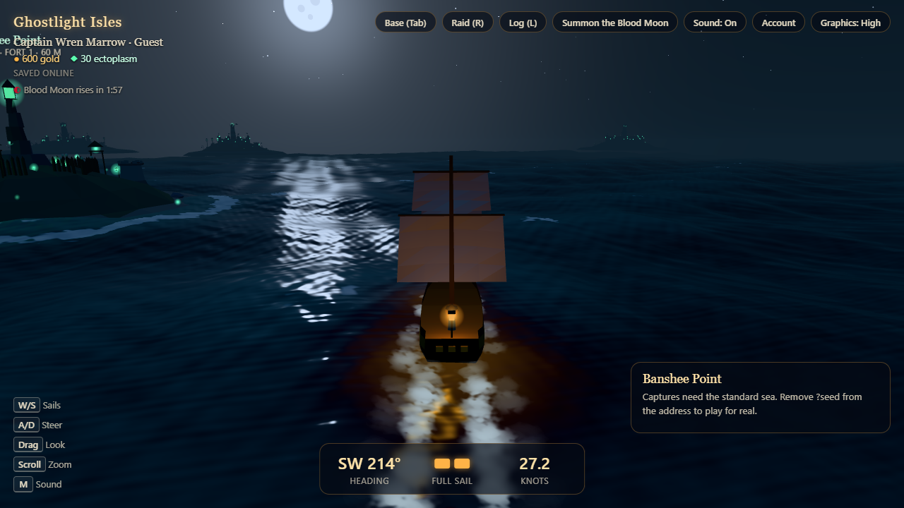
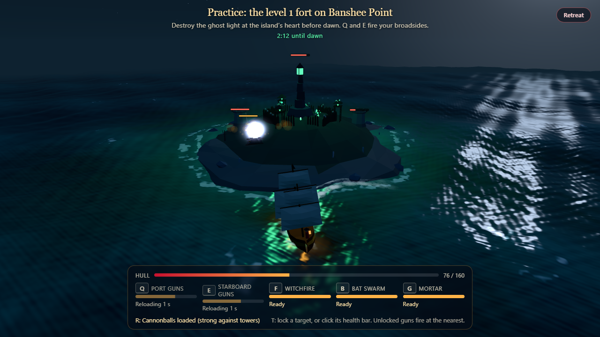
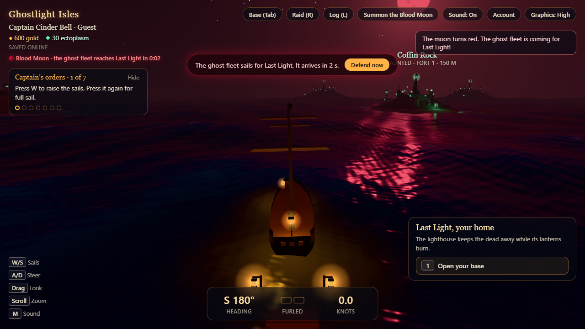
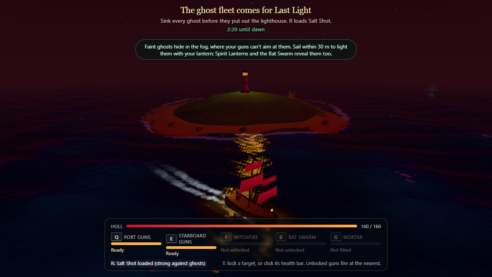
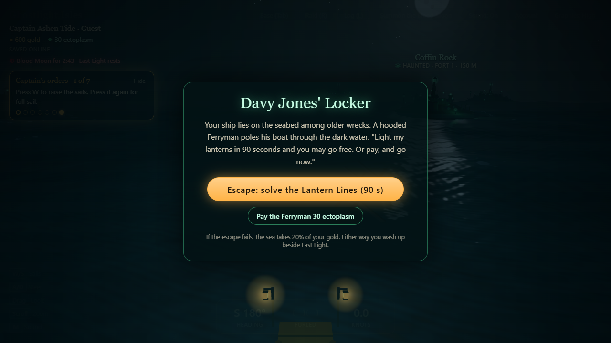

# Ghostlight Isles

A 3D pirate game that runs in the browser. Sail a fog-covered sea at night, capture haunted islands, build defenses on your home island, raid other captains' islands while they're away, and keep your lighthouse lit when the ghost fleet sails under the Blood Moon.

Built solo with [Kiro](https://kiro.dev) for [Kiroween 2026](https://kiroween.devpost.com/), in the **Costume Contest** category.



**Play:** live link coming soon (deployed from `main` on Netlify). Nothing to install; a guest captain is created on your first visit.

## Try it in two minutes

1. Press **Set sail**. The **Captain's orders** card under your name tells you the next thing to try and ticks itself off as you go.
2. Sail at the green-lit island ahead, **Coffin Rock**, a level-1 fort. Press **1**, then circle it firing **Q** and **E** until its ghost light falls (about 40 seconds). It's yours, and it pays tribute.
3. Press **Summon the Blood Moon**. The night turns red, a bell tolls, and the ghost fleet comes for Last Light. Salt Shot is loaded for you: sail close to light the ghosts with your lantern, then sink them with **Q** and **E**.
4. Press **R** at sea to raid a rival captain's island, then **L** to read the Captain's Log and the leaderboard.

Short on time? The title screen also has **Try a fort battle** and **Summon the Blood Moon**.

| | |
|---|---|
|  |  |
|  |  |

## What's in the game

- **Sailing:** a night sea with smooth wave lighting, ripples that catch the moon and lanterns, a reflected sky, whitecaps, surf along every coastline, fog and lantern light; 14 islands generated from a seed; three sail settings, steering with momentum and solid shores.
- **Accounts:** play as a guest at once, then pick a unique username and password to keep your captain and log in from any device. Every captain is saved in MongoDB; passwords are salted PBKDF2 hashes and logins are signed tokens.
- **Capturing islands:** break a haunted island's fort from your ship before dawn. Forts come in five levels, built from their seed as wooden stockades, ruins, curtain walls or star forts around a ghost spire, a broken lighthouse or a skull tower. Click a fort's name for its report. The reward adds gold for every gun silenced, for time left before dawn, for island ghosts sunk and for treasure vaults cracked; powder stores blow up the towers beside them. Captured islands pay gold every minute.
- **Forts get harder the further you sail:** five fort levels, set by distance from Last Light. Harder islands are bigger, with taller walls, more and stronger towers, mines, a bigger keep and ghost ships that rise from the island to hunt you. A new ship takes the level-1 forts; level 5 needs a fully refitted ship.
- **Base building on Last Light:** Cannon Towers, Spirit Lanterns (they reveal ghosts), Bone Catapults and Jack-o'-lantern Mines, three levels each, plus home upgrades for more slots and storage. The shipwright refits your hull, cannons, Salt Shot, Witchfire barrels, the Bat Swarm and the Pumpkin Mortar.
- **Raids (asynchronous multiplayer):** attack a saved copy of another captain's island while they're away. The server replays your battle from its seed and your inputs and pays loot only for what really happened. Raided islands get 4 hours of protection and a report. Ten rival captains keep the sea busy from the first minute, and a leaderboard ranks everyone by infamy.
- **The Blood Moon and the ghost fleet:** every 20 minutes the moon turns red for every player at once, and the fleet sails for your island. Its size grows with the cursed gold you hoard and the strength of your home.
- **Cursed gold:** ghost loot spends like gold but draws bigger fleets until the chapel cleanses it.
- **Davy Jones' Locker:** when your ship sinks you wake on the seabed. Solve a timed Lantern Lines escape or pay the Ferryman in ectoplasm. One crew member drowns and returns as a ghost, stronger for three battles.
- **Sound made in code:** the sea, wind, cannons, ghostly wails, the fleet's bell and the Blood Moon's heartbeat, all synthesized with Web Audio. No audio files.
- **Offline play:** with no server, the same rules run in your browser and save on your device.

## How the spooky design does a job

- **Fog hides, lanterns reveal.** Ghosts stay faint, and your guns can't aim at them until your stern lantern, a Spirit Lantern or the Bat Swarm lights them, so a lantern is a weapon.
- **Danger shows from afar.** Harder forts stand on bigger islands with taller walls and more green braziers, and every label says the fort's level in words.
- **Warm means living, green means dead.** Living ships and towers glow lantern orange (`#FFB347`); ghosts glow spectral green (`#5CFFB0`). Color is never the only cue: ghosts are see-through, shimmer, trail wisps and have their own silhouette, and labels say "haunted" or "yours" in words.
- **The Blood Moon is a warning.** Sky, sea and fog turn red, the fog thickens, a ship's bell tolls and a heartbeat starts. You know the fleet is coming without reading anything.
- **Sound is a second channel.** Every sinking, explosion and mine is always heard, even in the busiest moment of a battle, and sounds pan toward where they happened.
- **The Locker sounds and looks underwater.** The picture tints teal and blurs, bubbles rise and every sound is muffled, which makes the stakes of sinking clear.
- **Plain words in the interface.** Buttons say what they do ("Summon the Blood Moon", "Pay the Ferryman 30 ectoplasm"), and tips explain each threat as it appears.

## Controls

| Key | At sea | In battle |
|---|---|---|
| W / S | Raise or lower the sails | Same |
| A / D | Steer | Same |
| Q / E | | Fire the port or starboard broadside |
| R | Open the raid list | Switch between cannonballs and Salt Shot |
| F | | Throw a Witchfire barrel (once the shipwright fits one) |
| B | | Release the Bat Swarm (once the shipwright fits it) |
| G | | Fire the Pumpkin Mortar (once the shipwright fits it) |
| T | | Lock your guns on the next target; click a health bar to lock that one |
| Click an island's name | Read its fort report | |
| 1 | Island actions (attack the fort, open your base) | |
| Tab | Open or close your base | |
| L | Captain's Log and leaderboard | |
| M | Sound on or off | Same |
| Esc | Close panels | |
| Mouse drag / scroll | Look around / zoom | Same |

URL options: `?seed=any-text` for a different archipelago (for exploring; progress only counts in the standard sea), `?quality=low` for Low graphics, `?skipIntro` to skip the title screen, `?scenario=practice-fort` or `?scenario=practice-siege` for a practice battle, `?offline` to play without the server, and `?calm` to stop automatic Blood Moon sieges (for recording).

## Run it locally

You need Node.js 22 or newer.

```bash
npm install
npm run dev        # http://localhost:5173, with the game server at /api
```

| Command | What it does |
|---|---|
| `npm test` | All tests, including the property-based tests |
| `npm run typecheck` | TypeScript type check |
| `npm run build` | Type check, then a production build into `dist/` |
| `npm run smoke` | Opens the build in your installed Chrome or Edge, plays through every feature, checks the performance budget and saves screenshots |
| `npm run check:assets` | Checks that every third-party asset is credited with an allowed license |

**Deploy:** on Netlify choose *Add new site → Import an existing project*, pick this repository and deploy. `netlify.toml` sets the build, and the game server (`netlify/functions/api.mts`) stores captains in MongoDB. Before deploying, set `MONGODB_URI`, `MONGODB_DB` (`ghostlight`) and `JWT_SECRET` (at least 32 random characters) in the site's environment variables, and allow `0.0.0.0/0` under Network Access in Atlas. Without them the game still runs, saving on each player's device. For local development, copy `.env.example` to `.env`.

## How it's built

- **TypeScript, Three.js and Vite**, with no game engine. Every model, texture and sound is made in code, so the whole game is about 200 KB gzipped.
- **A deterministic simulation** in `src/sim/`: pure functions, a fixed 30 ticks per second and seeded randomness only. A battle is fully decided by its seed, the defender's layout and the attacker's inputs, which is what lets the server replay it.
- **One server, three places.** The game server's rules in `src/server/` use only web standards, so the same handler runs as a Netlify Function, inside Vite's dev and preview servers, and in the browser when offline.
- **The client is never trusted.** The server replays every fort battle, raid and siege, checks every puzzle answer, and charges every cost itself.
- **The renderer and the sound only read the simulation.** Waves, bobbing, wakes, glows and every sound come from the simulation's state and events.
- **Performance budget:** 60 fps on Intel Iris Xe integrated graphics at 1280×720, 18 to 38 draw calls (budget 150) and 3 point lights (budget 4). The smoke test fails the build if the budget is broken.

## How Kiro is used

Everything Kiro uses lives in [`.kiro/`](.kiro), and a running log of what each feature caught is in [Documents/kiro-usage-log.md](Documents/kiro-usage-log.md).

- **Specs:** [twelve specs](.kiro/specs), one per game system, each written before its code: EARS requirements, a design with numbered correctness properties (77 in all), and tasks.
- **Property-based tests:** every correctness property is a fast-check test with the same number and name. They found a floating-point bug in the wave phases, and they keep the server and the rules from drifting apart. Example and balance tests from the same specs found forts whose keeps were out of reach, twice.
- **Steering:** product, tech and structure rules always load; simulation, rendering and testing conventions load only for matching files; the game design loads automatically for gameplay work, so balance numbers are always at hand.
- **Hooks:** a session brief with the time left and the next feature; a commit gate that blocks commits unless tests, types and asset credits pass (it caught a test runner that only worked from some terminals); a simulation test run after every change to the game rules; and a credit check for new assets.
- **A browser smoke test driven by the specs' tasks** plays every feature in real Chrome. It caught problems no unit test could: a glowing beam that swallowed puzzle clicks, and the Locker covering its own escape puzzle.

## Project documents

The idea brief, game design, build plan, submission checklist, Kiro usage log and credits are in [Documents/](Documents).

## License

[MIT](LICENSE). Third-party credits are in [Documents/credits.md](Documents/credits.md).
